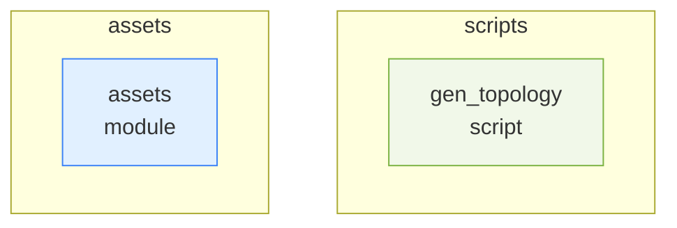

# {{PROJECT_NAME}} — Repository Topology Map

> Auto-generated by `repo-doc-miner/scripts/gen_topology.py` (v2, topology-first), then **human-refined**. This is the **first deliverable** of the mining process: a structural map of the repository. Keep this file open while writing the other four files.

---

## 1. Structural Topology

> Top-level structure: each subgraph is a top-level module; nodes are the entities it contains, color-coded by kind. Node ids are derived from the repo-relative path (`sanitize_id`), and the label is the entity name and kind joined by a `<br/>` line break. Build/vendor directories (`.git`, `node_modules`, `dist`, `.github`, `*.egg-info`, …) are skipped.



## 2. Dependency Edges

> Solid arrows = `uses`; dotted arrows = `source → copy` (a single source of truth synced into copies), labeled `synced`. The `source → copy` edges are the most important — they reveal duplication that flat file scanning would misinterpret. Edge order is sorted by `(src, dst, kind)`, so re-running the script yields a stable diff.

```mermaid
graph LR
    SKILL_md --> references["references"]
    SKILL_md -.-> scripts_scaffold_docs_py["scaffold_docs"] synced
```

| Edge | Mechanism | How to verify |
| --- | --- | --- |
| (source file path) → (copy file path) | (sync mechanism, e.g. `sync-agent-skills.py` or `system.file:`) | (script/field to confirm) |
| (source entity) → (target entity) | (relationship) | (how to confirm) |

## 3. Entity Inventory

> Emitted by the script as `| Kind | Count | Example locations |`, counting distinct entities per kind.

| Kind | Count | Example locations |
| --- | --- | --- |
| (kind, e.g. `module`, `script`, `py-package`) | (count) | (comma-separated paths from `gen_topology.py`) |

## 4. Module Deep-Dive Scaffold

> Filled during Phase 2 (module deep-dive), walking modules **along the edges above**, highest complexity first.

### (module name, e.g. `scripts`)

- **(entity name)** (`(kind)`) — `(repo-relative path)`
  - Responsibility: (one-line summary of what this module does)
  - References: (entities this one points to, in `gen_topology.py` terminology)
  - > TODO(doc-miner): (any unresolved gap)

### (module name, e.g. `assets`)

- **(entity name)** (`(kind)`) — `(repo-relative path)`
  - Responsibility: (one-line summary)

---

> This map is the backbone for `developer_guide.md`, `user_guide.md`, and `tutorial.md`. Re-run `scripts/gen_topology.py` to diff structural changes as the repo evolves.
